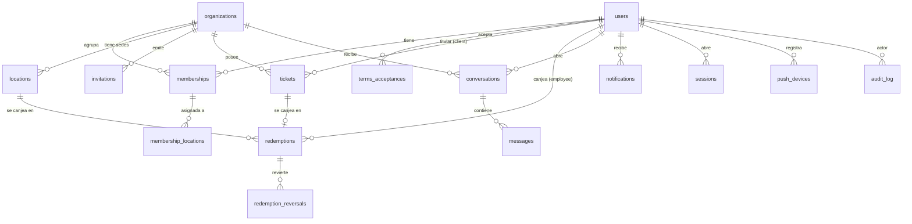
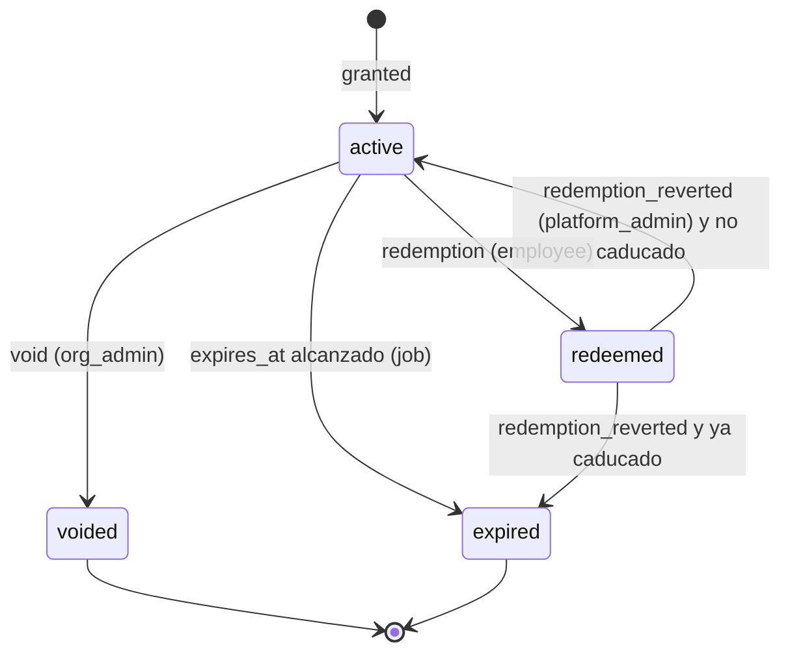

# 05 — Modelo de dominio y de datos

Base de datos: PostgreSQL. Identificadores: **UUID v7** (ordenables por tiempo, no enumerables). Fechas: `timestamptz` en UTC. Nombres en `snake_case`, inglés.

## Diagrama

## Tablas

### Identidad y tenancy

| Tabla | Campos principales | Notas |
|---|---|---|
| `users` | `id`, `email` (citext, único), `password_hash` (argon2id), `name`, `phone`, `locale`, `avatar_key`, `is_platform_admin`, `email_verified_at`, `mfa_secret_enc`, `status` (`active`/`blocked`/`deleted`), `created_at`, `deleted_at` | Un único usuario global por email |
| `organizations` | `id`, `name`, `slug` (único), `legal_name`, `tax_id`, `vertical`, `timezone`, `status` (`active`/`suspended`/`closed`), `settings` (jsonb), `created_at` | `vertical` = `driving_school` inicialmente. Sin campo de plan: la facturación queda fuera de la aplicación |
| `locations` | `id`, `organization_id`, `name`, `address`, `active`, `created_at` | Sedes. Toda organización tiene al menos una (se crea una por defecto). Atributo, no límite de permisos |
| `membership_locations` | `membership_id`, `location_id` | Sedes asignadas a un empleado/`org_admin` |
| `terms_acceptances` | `id`, `user_id`, `document` (`terms`/`privacy`), `version`, `accepted_at`, `ip` | Se vuelve a pedir si cambia la versión (RF-AUTH-10) |
| `memberships` | `id`, `organization_id`, `user_id`, `role` (`client`/`employee`/`org_admin`), `status` (`active`/`suspended`/`removed`), `created_at`, `removed_at` | Único `(organization_id, user_id)`. Borrado lógico |
| `invitations` | `id`, `kind` (`org_onboarding`/`member`), `organization_id` (nullable en onboarding), `email`, `role`, `token_hash`, `expires_at`, `used_at`, `used_by`, `revoked_at`, `invited_by` | Token aleatorio 256 bit; solo se guarda su hash. Un solo uso |
| `sessions` | `id`, `user_id`, `token_hash`, `device_label`, `ip`, `user_agent`, `mfa_verified_at`, `created_at`, `last_used_at`, `expires_at`, `revoked_at` | Sesiones opacas en servidor |
| `password_resets` / `email_verifications` | `id`, `user_id`, `token_hash`, `expires_at`, `used_at` | Un solo uso |

### Tickets (núcleo del negocio)

| Tabla | Campos principales | Notas |
|---|---|---|
| `ticket_types` | `id`, `organization_id`, `name`, `description`, `metadata` (jsonb, clave/valor libres), `default_validity_days` (nullable), `active` | Definidos por la organización (RF-TKT-07). Se crea un tipo por defecto con la organización |
| `tickets` | `id`, `organization_id`, `client_id` (→ users), `ticket_type_id`, `metadata` (jsonb, copia del tipo al emitir), `status`, `granted_by`, `granted_at`, `expires_at` (nullable), `note`, `batch_id`, `short_code`, `static_qr_version` (int) | `status` es una **proyección** del libro de eventos. `short_code` único por organización (RF-RDM-07). `static_qr_version` se incrementa al regenerar el QR impreso (RF-TKT-12) |
| `redemptions` | `id`, `ticket_id` (FK), `organization_id`, `location_id`, `client_id`, `employee_id`, `redeemed_at`, `qr_kind` (`dynamic`/`static`), `device_id`, `idempotency_key`, `ip` | **Append-only**. Sin `UPDATE`/`DELETE` (permisos de BD + trigger) |
| `redemption_reversals` | `id`, `redemption_id` (único), `reverted_by` (platform admin), `reason`, `reverted_at` | **Append-only**. Una reversión devuelve el ticket a `active` (si no ha caducado) |
| `ticket_events` | `id`, `ticket_id`, `type` (`granted`/`redeemed`/`redemption_reverted`/`voided`/`expired`/`static_qr_regenerated`), `actor_id`, `data`, `at` | Libro de eventos append-only; base de estadísticas y reconstrucción |

### Comunicación

| Tabla | Campos principales |
|---|---|
| `conversations` | `id`, `organization_id`, `client_id`, `subject`, `category` (`question`/`claim`), `related_ticket_id`, `related_redemption_id`, `status` (`open`/`closed`), `created_at`, `closed_at` |
| `messages` | `id`, `conversation_id`, `sender_id`, `body`, `created_at`, `read_by_org_at`, `read_by_client_at` |
| `notifications` | `id`, `user_id`, `organization_id`, `type`, `payload` (jsonb), `created_at`, `read_at` |
| `push_devices` | `id`, `user_id`, `platform` (`android`/`ios`/`web`), `token`, `app_version`, `last_seen_at` |
| `notification_prefs` | `user_id`, `type`, `channel`, `enabled` |

### Transversales

| Tabla | Campos principales | Notas |
|---|---|---|
| `audit_log` | `id`, `at`, `actor_id`, `impersonator_id`, `organization_id`, `action`, `entity`, `entity_id`, `metadata`, `ip` | Append-only. Sin datos sensibles en `metadata` |
| `idempotency_keys` | `key`, `user_id`, `route`, `request_hash`, `response`, `created_at` | TTL 24 h |
| `jobs` (pg-boss) | gestionada por la librería | Cola de trabajos (emails, push, caducidades) |

## Estados del ticket

## Invariantes (deben ser tests)

1. Un ticket tiene como máximo **una** redención no revertida (`UPDATE tickets SET status='redeemed' WHERE id=$1 AND status='active' RETURNING` dentro de la misma transacción que inserta en `redemptions`).
2. `redemptions.organization_id = tickets.organization_id` y el empleado tiene membership `employee`/`org_admin` activa en ella.
3. `redemptions.employee_id <> redemptions.client_id` (sin auto-canje).
4. `redemptions` y `redemption_reversals`, `ticket_events` y `audit_log` no admiten `UPDATE`/`DELETE` por parte del rol de la aplicación.
5. Una organización nunca se queda sin `org_admin` activo.
6. El cliente titular debe tener membership activa en la organización del ticket al emitirlo.
7. `redemptions.location_id` pertenece a la misma organización y el empleado está asignado a esa sede (obligatoria si la organización tiene más de una).
8. Un QR estático solo es válido si su `static_qr_version` coincide con la del ticket.

## Multi-tenancy

- Esquema único, columna `organization_id` en todas las tablas de negocio.
- **Row Level Security** de PostgreSQL con `current_setting('app.org_id')` fijado por transacción desde el middleware. Es una defensa en profundidad: un bug de la aplicación no debe poder cruzar organizaciones.
- La aplicación se conecta con un rol sin `BYPASSRLS`; solo el rol de migraciones/operaciones lo tiene.

## Borrado y retención (RGPD)

- Borrado de cuenta: `users` se **anonimiza** (`name='Usuario eliminado'`, email sustituido por hash, sin teléfono ni avatar). Los registros del libro (canjes, eventos, auditoría) se conservan referenciando al usuario anonimizado, por interés legítimo contable/de auditoría de la organización.
- Mensajes de un usuario anonimizado: el cuerpo se elimina o se conserva según política de la organización (ver [privacidad](09-seguridad-y-privacidad.md)).
- Baja de organización: exportación entregada, `status='closed'`, purga física tras el periodo de retención acordado.
- Retención: sesiones caducadas 30 días; idempotency keys 24 h; audit_log 24 meses (revisable).

## Índices relevantes

- `tickets (organization_id, client_id, status)`
- `tickets (organization_id, status, expires_at)` para el job de caducidad
- `redemptions (organization_id, redeemed_at)`, `(organization_id, employee_id, redeemed_at)`, `(organization_id, client_id, redeemed_at)`
- `redemptions (organization_id, location_id, redeemed_at)`
- `memberships (user_id) WHERE status='active'`
- `notifications (user_id, read_at, created_at)`

Estadísticas: consultas directas con agregaciones sobre estos índices; si el volumen lo requiere, vistas materializadas o tabla `stats_daily` actualizada por job (ver [arquitectura](06-arquitectura.md)).
