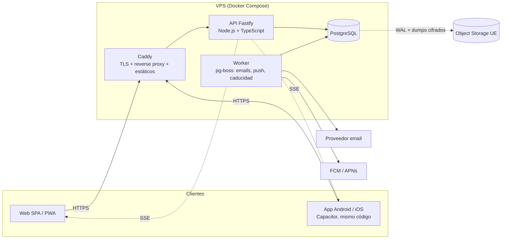

# 06 — Arquitectura

## Vista general



## Principios arquitectónicos

- **Monolito modular** en el backend: un solo despliegue, módulos con fronteras claras (`auth`, `orgs`, `tickets`, `redemptions`, `stats`, `messaging`, `notifications`, `audit`). Se puede extraer un módulo a servicio si algún día hace falta; hoy no.
- **API sin estado**: todo el estado en PostgreSQL. Esto permite varias instancias detrás de Caddy.
- **Un único cliente** (React) para web y móvil: Capacitor envuelve la SPA en Android/iOS y aporta plugins nativos (cámara/escáner, push, almacenamiento seguro, deep links).
- **Contratos compartidos**: los esquemas Zod viven en un paquete común y generan tipos TypeScript y OpenAPI. Cliente y servidor no pueden divergir silenciosamente.
- **Tenancy en los datos**: `organization_id` + RLS (ver [modelo](05-modelo-de-dominio.md)).
- **Cola en PostgreSQL** (pg-boss) en lugar de Redis/RabbitMQ: un servicio menos que operar.

## Módulos del backend

| Módulo | Responsabilidad |
|---|---|
| `auth` | Registro por invitación, login, sesiones, MFA, reset de contraseña |
| `orgs` | Organizaciones, memberships, invitaciones, ajustes |
| `tickets` | Emisión, anulación, caducidad, consulta, firma de QR |
| `redemptions` | Preview, canje atómico, reversión (platform admin) |
| `stats` | Consultas agregadas por rol y filtros |
| `messaging` | Conversaciones y mensajes |
| `notifications` | Creación, preferencias, entrega (in-app/push/email), SSE |
| `audit` | Registro append-only |
| `platform` | Operaciones del administrador de plataforma |

Estructura interna de cada módulo: `routes` → `service` (reglas de negocio) → `repository` (SQL con Drizzle). Las políticas de permisos viven en `policies` y se invocan siempre desde `service`, nunca desde la UI.

## Flujo del QR y del canje

### Diseño del QR (decisión de seguridad)

Hay **dos tipos de QR** por ticket, porque los tickets también pueden imprimirse (RF-TKT-10/11):

| | QR dinámico (pantalla) | QR estático (impreso) |
|---|---|---|
| Formato | `v1d.<ticketId>.<exp>.<nonce>.<firma>` | `v1s.<ticketId>.<qrVersion>.<firma>` |
| Validez | 90 s; la app lo renueva mientras la pantalla está abierta | Hasta que el ticket deje de estar activo o se regenere (`static_qr_version`) |
| Se obtiene con | `POST /v1/orgs/{orgId}/tickets/{ticketId}/qr` | Dentro del PDF (`GET .../tickets/{id}/pdf`) |
| Riesgo | Captura de pantalla reenviada: acotado a 90 s | Copia o fotografía del papel, igual que un vale en papel |
| Mitigaciones | Un solo uso, estado en BD | Un solo uso (el segundo escaneo se rechaza), regeneración que invalida los impresos, registro del tipo (`qr_kind`) y auditoría; la organización puede desactivar el QR estático en sus ajustes |

Común a ambos:
1. Firma HMAC-SHA256 con clave del servidor, rotable con `kid`; no hay datos personales en el QR.
2. La validación comprueba firma, caducidad (dinámico), `qrVersion` (estático), organización, estado del ticket y rol del empleado.
3. El canje es de **un solo uso** y comprueba el estado en base de datos, así que no depende de la vida del token.
4. El PDF solo lo genera el titular o un `org_admin`; el servidor lo genera bajo demanda, no se almacena.

### Secuencia de canje

```mermaid
sequenceDiagram
    participant C as Cliente (app)
    participant E as Empleado (app)
    participant API as API
    participant DB as PostgreSQL
    C->>API: POST /tickets/{id}/qr
    API-->>C: token firmado (90 s)
    C->>C: muestra QR
    E->>E: escanea QR
    E->>API: POST /redemptions/preview {token}
    API->>API: valida firma, exp, organización, rol del empleado
    API->>DB: lee ticket (estado, titular)
    API-->>E: datos para confirmar (cliente, tipo, saldo)
    E->>API: POST /redemptions {token} + Idempotency-Key
    API->>DB: BEGIN; UPDATE tickets SET status='redeemed' WHERE id=? AND status='active' RETURNING
    alt 1 fila afectada
        API->>DB: INSERT redemptions, ticket_events, audit_log; encola notificación; COMMIT
        API-->>E: 201 canjeado
        API-->>C: SSE ticket.redeemed
    else 0 filas
        API->>DB: ROLLBACK
        API-->>E: 409 ya canjeado / no activo
    end
```

Garantías: atomicidad (una transacción), idempotencia (`Idempotency-Key` + `UNIQUE`), sin dobles canjes ante concurrencia (el `UPDATE ... WHERE status='active'` serializa el acceso a la fila).

## Tiempo real

**Server-Sent Events** (`GET /v1/events`) para notificaciones y para que la pantalla de QR del cliente se actualice tras el canje. Más simple que WebSockets y suficiente (comunicación unidireccional). Fallback a polling corto.

## Estadísticas

1. Fase MVP: consultas SQL agregadas con `date_trunc` en la zona horaria de la organización sobre los índices de `redemptions`/`tickets`.
2. Si p95 > 1 s: vistas materializadas o tabla `stats_daily` (por `organization_id`, `day`, `employee_id`, `client_id`) refrescada por el worker.
3. Si sigue sin bastar: réplica de lectura.

## Ruta de escalado

| Nivel | Cuándo | Acción |
|---|---|---|
| 0 | Hasta ~10 orgs (holgura para más) | Un VPS 2 vCPU/4 GB, todo en Compose |
| 1 | CPU/RAM al límite | Subir de tamaño el VPS (vertical) |
| 2 | BD compite con API | BD a un VPS propio o gestionada (UE) |
| 3 | Disponibilidad/tráfico | 2+ instancias API tras Caddy/balanceador; worker aparte |
| 4 | Lecturas pesadas | Réplica de lectura para estadísticas |
| 5 | Muy grande | Particionado de `redemptions`/`ticket_events` por fecha |

## Cliente (web y móvil)

- SPA React; TanStack Router (rutas por rol/organización) y TanStack Query (caché, reintentos, invalidación por SSE).
- Contexto de **organización activa** seleccionable; la navegación y permisos de UI derivan del rol en esa organización (la autoridad real es siempre el servidor).
- Capa `platform/` que abstrae las diferencias web/nativo (escáner, push, almacenamiento seguro, share).
- Almacenamiento de sesión: web → cookie `HttpOnly; Secure; SameSite=Lax`; móvil → token en Keychain/Keystore.
- Escáner: plugin ML Kit de Capacitor (Android/iOS); en web, el escaneo es opcional vía `BarcodeDetector`/librería JS, pero el flujo principal es móvil.

## Observabilidad

Logs JSON (Pino) con `request_id`, `user_id`, `org_id`; errores a Sentry (SaaS UE); métricas básicas (Prometheus) y chequeos externos. Detalle en [despliegue](11-despliegue-e-infraestructura.md).
