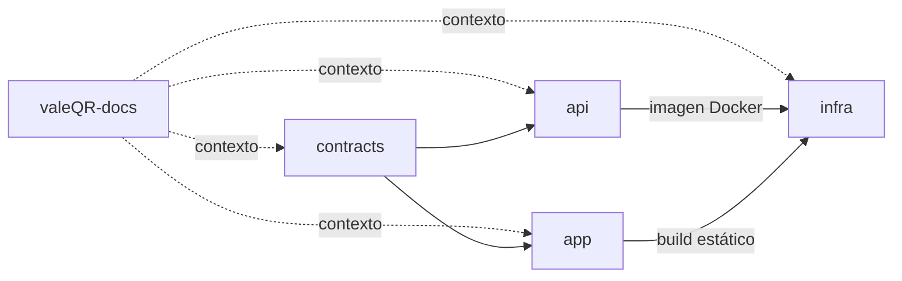

# 10 — Repositorios

## Estrategia

Varios repositorios pequeños (como propone la descripción), cada uno con su `AGENTS.md` y su `docs/index.md` (ver [plantillas](../templates/repo/)). El **repositorio de documentación** es la fuente de verdad de producto; cada repo de código documenta sus detalles técnicos en `docs/`.

Cuenta en GitHub: `gonzalodiazcanavate`. Todos los repos son **privados** y se acceden por SSH.

## Repositorios

| Repo | URL | Contenido | Tecnología |
|---|---|---|---|
| `valeQR-docs` | `git@github.com:gonzalodiazcanavate/valeQR-docs.git` | Esta documentación: producto, requisitos, arquitectura, plantillas de agentes/skills, marca, borradores legales | Markdown, Mermaid, SVG |
| `valeQR-contract` | `git@github.com:gonzalodiazcanavate/valeQR-contract.git` | Esquemas Zod, tipos, errores de dominio, constantes (roles, estados). Paquete `@autoqr/contract`, consumido por tag de git (ver nota) | TypeScript |
| `valeQR-api` | `git@github.com:gonzalodiazcanavate/valeQR-api.git` | Backend: API Fastify, worker pg-boss, migraciones, tests | Node.js, Fastify, Drizzle, PostgreSQL |
| `valeQR-app` | `git@github.com:gonzalodiazcanavate/valeQR-app.git` | Cliente único: SPA web + proyectos Capacitor Android/iOS | React, Vite, Tailwind, Capacitor |
| `valeQR-infra` | `git@github.com:gonzalodiazcanavate/valeQR-infra.git` | Docker Compose, Caddy, scripts de despliegue y backup, runbooks, monitorización | Docker, Bash, YAML, sops/age |

> Los nombres de repo conservan el prefijo `valeQR`; el producto se llama **AutoQR**.

> **Distribución del contrato**: `api` y `app` lo declaran como dependencia git fijada por tag (`git+ssh://git@github.com/gonzalodiazcanavate/valeQR-contract.git#vX.Y.Z`). `dist/` **va versionado** en el repo del contrato (pnpm no ejecuta scripts de build de dependencias git sin una lista de permitidos ligada al commit) y `zod` es *peerDependency* para compartir una sola copia. Evita operar un registro privado. La CI de `api` y `app` necesita la deploy key `CONTRACT_DEPLOY_KEY`. Si más adelante molesta, pasar a GitHub Packages (o a monorepo).



> Alternativa considerada: monorepo (pnpm workspaces) con `api`, `app`, `contract`. Es más simple para cambios transversales (un único PR). **Decisión (responsable indiferente, criterio del agente)**: se mantiene multi-repo, ya creado, con el contrato por tag de git; **si la fricción de contratos resulta alta, migrar a monorepo es la primera optimización** (ver ADR-009).

## Estructura propuesta por repo

### `valeQR-api`
```
AGENTS.md
docs/
  index.md
  modules/            # un doc de contexto por funcionalidad/módulo
src/
  modules/<mod>/{routes,service,repository,policies}.ts
  db/{schema,migrations,rls}
  jobs/
  plugins/            # auth, csrf, rate-limit, request-context
  main.ts, worker.ts
test/{unit,integration,isolation,authz}
Dockerfile
```

### `valeQR-app`
```
AGENTS.md
docs/index.md, docs/features/
src/
  features/<feature>/{routes,components,api,hooks}
  platform/           # abstracción web/nativo: scanner, push, secure-storage
  ui/                 # componentes base (shadcn)
  i18n/
android/, ios/        # proyectos Capacitor
e2e/                  # Playwright
```

### `valeQR-infra`
```
AGENTS.md
docs/index.md, docs/runbooks/
compose/{prod,staging}/
caddy/
scripts/{deploy,backup,restore-test}
secrets/              # cifrados con sops
```

## Flujo de ramas y versiones

- Trunk-based: `main` protegida, ramas cortas `feat/...`, `fix/...`, PR obligatorio con CI en verde.
- Commits convencionales (`feat:`, `fix:`, `docs:`, `chore:`), versionado semántico por repo.
- `valeQR-contract` etiqueta versiones `vMAJOR.MINOR.PATCH` y los consumidores las fijan; cambios incompatibles requieren `MAJOR` y `API v2` o campo opcional.
- Entornos: PR → CI; `main` → `staging` automático; tag `vX.Y.Z` → `prod` con aprobación manual.
- Apps móviles: versión de store independiente (`versionName`/`CFBundleShortVersionString`), con versión mínima soportada controlada desde `/v1/app-config`.

## Plantilla mínima de CI (por repo)

`lint` → `typecheck` → `test` (con PostgreSQL vía Testcontainers) → `build` → `audit` (deps + gitleaks + Trivy) → publicar imagen (API) / artefactos (app).
