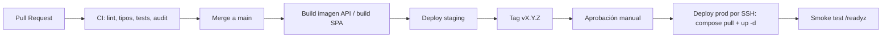

# 11 — Despliegue e infraestructura

## Entornos

| Entorno | Dónde | Uso |
|---|---|---|
| `local` | Docker Compose del desarrollador | Desarrollo y agentes |
| `staging` | Mismo VPS (stack Compose separado, BD separada) o VPS mínimo | Validación de PRs fusionados, pruebas de apps (TestFlight / pruebas internas) |
| `prod` | VPS principal | Producción |

Dominios (previstos; `autoqr.com` pendiente de registrar):

| Host | Uso |
|---|---|
| `app.autoqr.com` | Web SPA |
| `api.autoqr.com` | API |
| `staging.autoqr.com` / `api.staging.autoqr.com` | Staging |
| `autoqr.com` | Landing mínima y enlaces legales |
| `status.autoqr.com` | Página de estado (opcional) |

DNS con registros A/AAAA y CAA; SPF, DKIM y DMARC para el correo saliente (esencial para la entregabilidad de invitaciones). Buzón de soporte: `soporte@autoqr.com` (puede cambiar).

## VPS recomendado

- Proveedor con centro de datos en la **UE** (preferible España) y bajo coste. **Presupuesto objetivo: ~10 €/mes** en total (VPS + almacenamiento de backups); se amplía si hace falta.
- Dimensionamiento inicial: 2 vCPU / 4 GB RAM / 40+ GB NVMe, suficiente para 1 organización piloto y hasta ~10 a medio plazo. Ubuntu LTS.
- Staging comparte VPS con límites de recursos (o se levanta bajo demanda); se separa si el presupuesto lo permite.
- Firewall del proveedor + `ufw`: solo 22 (restringido por IP si es posible), 80, 443.
- SSH con clave, sin contraseña ni root; `unattended-upgrades`; `fail2ban`.

## Topología Docker Compose (prod)

| Servicio | Imagen | Notas |
|---|---|---|
| `caddy` | `caddy:2` | TLS automático, HTTP/3, sirve el estático de la SPA, proxy a `api`, cabeceras de seguridad, rate limiting, `.well-known` para app links |
| `api` | `ghcr.io/gonzalodiazcanavate/valeqr-api:<tag>` | Usuario no root, healthcheck `/readyz`, límite de memoria |
| `worker` | misma imagen, comando `worker` | Jobs: emails, push, caducidad, limpieza |
| `postgres` | `postgres:<LTS>` | Volumen dedicado, no expuesto, `archive_mode` hacia pgBackRest |
| `pgbackrest` | sidecar o cron en el host | Backups y archivado WAL |

Errores: Sentry SaaS (región UE, plan gratuito); GlitchTip autoalojado necesita BD y recursos propios y no cabe en el presupuesto inicial.

Red interna `backend` (sin salida a internet salvo `api`/`worker`); solo `caddy` publica puertos.

## CI/CD

- **API**: imagen a GHCR con tag inmutable (SHA y semver). El despliegue ejecuta migraciones **antes** de levantar la nueva versión (job `migrate` una sola vez); las migraciones deben ser compatibles hacia atrás (patrón expand/contract) para permitir rollback.
- **Web**: build estático servido por Caddy desde un volumen; despliegue atómico (carpeta versionada + symlink).
- **Rollback**: re-desplegar el tag anterior; si hubo migración, solo con migraciones expand/contract. Procedimiento en runbook.
- **Móvil**: GitHub Actions (runner macOS para iOS) → Fastlane → TestFlight / Google Play pruebas internas → producción por revisión manual.
- Despliegue sin downtime visible: reinicio rápido de la API (<10 s) y reintentos del cliente con idempotencia; evolucionar a blue/green con Caddy si hace falta.

## Backups y recuperación

| Elemento | Frecuencia | Destino | Retención |
|---|---|---|---|
| WAL continuo | Continuo | Object Storage UE (cifrado) | 14 días |
| Backup base completo | Semanal (+ diferencial diario) | Object Storage UE (cifrado) | 4 semanas |
| `pg_dump` lógico cifrado (restic) | Diario | Otro proveedor/región | 30 días |
| Configuración e infra | Cada commit | Repositorio `valeQR-infra` (secretos con sops) | — |

- RPO ≤ 15 min, RTO ≤ 4 h.
- **Prueba de restauración trimestral** automatizada en staging (`scripts/restore-test`) con verificación de integridad (conteos e invariantes del [modelo](05-modelo-de-dominio.md)).
- Claves de cifrado de backups guardadas fuera del VPS.

## Observabilidad

| Señal | Herramienta | Alertas |
|---|---|---|
| Disponibilidad | Uptime Kuma (externo) sobre `/readyz` y la web | Caída > 2 min |
| Logs | Pino JSON → Docker → rotación local (+ Loki opcional) | — |
| Errores | Sentry SaaS UE (plan gratuito) | Nuevos errores, picos |
| Métricas | `/metrics` (Prometheus) + Grafana (fase S) | CPU, RAM, disco > 80 %, latencia p95, tasa 5xx, cola de jobs |
| Auditoría de negocio | `audit_log` | Reversiones de canje, logins de admin, picos de canjes por empleado |
| Backups | Healthcheck de cron (p. ej. healthchecks.io) | Backup no completado |

## Configuración y secretos

- Config por variables de entorno validadas con Zod al arrancar (fallar rápido).
- Secretos en `valeQR-infra/secrets/*.enc` (sops + age); la clave `age` privada solo en el VPS y en custodia segura del operador.
- Claves de firma de QR con `kid` y rotación programada (solapamiento de claves para tokens vivos).

## Apps móviles: requisitos de publicación

| Tema | Detalle |
|---|---|
| Cuentas | Google Play Console, Apple Developer Program |
| Identificadores | `com.autoqr.app` |
| Enlaces profundos | `/.well-known/assetlinks.json` y `apple-app-site-association` servidos por Caddy |
| Push | Proyecto Firebase (FCM) y clave APNs |
| Revisión Apple | Proporcionar cuenta demo; justificar que las cuentas las crean las organizaciones (B2B); incluir borrado de cuenta in-app y enlace a política de privacidad |
| Fichas | Política de privacidad, declaración de datos (Data safety / App Privacy), capturas |

## Runbooks a escribir en `valeQR-infra`

Despliegue, rollback, restauración de BD, rotación de claves (QR, sesiones, backups), respuesta a incidentes, alta/baja de VPS, renovación de certificados (Caddy automático), actualización de PostgreSQL mayor.
