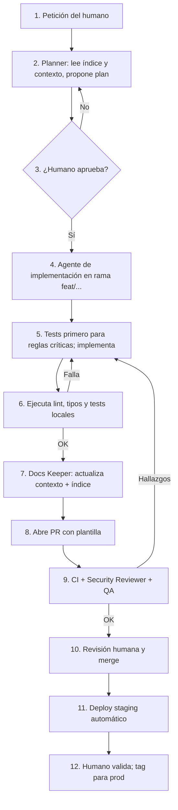

# 13 — Desarrollo agéntico

El desarrollo lo realizan agentes de IA supervisados por una persona. La documentación es el contrato: los agentes leen el contexto, implementan, verifican y **actualizan la documentación**. Este documento define cómo.

## 1. Principios

1. **Contexto antes de código**: ningún agente escribe código sin haber leído el documento de contexto de la funcionalidad.
2. **Documentación = parte del cambio**: un PR que cambia comportamiento sin actualizar su documento de contexto no se acepta.
3. **Pasos pequeños y verificables**: cada tarea termina con tests y comprobaciones automáticas en verde.
4. **El humano decide** en: seguridad, modelo de datos, decisiones de producto, despliegues a producción, gasto y acciones destructivas.
5. **Los agentes no manejan secretos reales** ni acceden a producción; solo CI/CD y el operador.

## 2. Estructura de contexto en cada repositorio

```
AGENTS.md              # raíz: descripción breve, prácticas, puntero al índice
docs/index.md          # funcionalidades → documentos de contexto
docs/<area>/<doc>.md   # contexto profundo de cada funcionalidad
.github/agents/*.agent.md     # definiciones de agentes (ver plantillas)
.github/skills/*/SKILL.md     # skills reutilizables
.github/copilot-instructions.md (opcional, apunta a AGENTS.md)
```

Plantillas en [templates/](../templates/). Ver [AGENTS.md de ejemplo](../templates/repo/AGENTS.md), [index.md de ejemplo](../templates/repo/index.md) y [documento de contexto](../templates/repo/context-doc.md).

### Protocolo obligatorio ("loop de contexto")

Descrito en cada `AGENTS.md`:

1. Leer `docs/index.md`.
2. ¿La petición encaja con una funcionalidad listada? → leer su documento de contexto y los enlazados.
3. ¿No encaja? → es una funcionalidad nueva: planificar y **crear** un documento de contexto desde la plantilla.
4. Implementar el cambio.
5. Actualizar el documento de contexto (o crearlo) y `docs/index.md`.
6. Si el cambio afecta a otros repos (contrato API, modelo de datos, infra), actualizar el documento del repo correspondiente y/o abrir una tarea en él, y reflejarlo en `valeQR-docs`.

## 3. Roles de agente

| Agente | Responsabilidad | Herramientas/permisos | Entrada → Salida |
|---|---|---|---|
| **Planner** | Convierte una necesidad en un plan con tareas, criterios de aceptación y documentos afectados | Lectura de repos y docs | Petición → plan + checklist |
| **Backend** | Implementa API, migraciones, jobs en `valeQR-api` | Lectura/escritura en `valeQR-api` y `valeQR-contract`; terminal para tests | Tarea → PR con código, tests y docs |
| **Frontend/Mobile** | Implementa UI y capa nativa en `valeQR-app` | Lectura/escritura en `valeQR-app`; terminal para build/test | Tarea → PR con UI, tests y docs |
| **QA** | Escribe y ejecuta tests E2E, de aislamiento y de autorización; busca casos límite | Lectura general, escritura en carpetas de test | PR/Funcionalidad → informe + tests |
| **Security Reviewer** | Revisa PRs contra [seguridad](09-seguridad-y-privacidad.md), OWASP y checklist de release | Solo lectura | PR → informe de hallazgos |
| **Docs Keeper** | Verifica que índice y contexto estén sincronizados con el cambio; mantiene `valeQR-docs` | Escritura en docs | Diff → docs actualizadas o lista de lagunas |
| **DevOps** | Mantiene `valeQR-infra`, pipelines, runbooks | Escritura en `valeQR-infra`; sin acceso a prod | Tarea → PR de infra |

Definiciones concretas (formato `*.agent.md`) en [templates/agents/](../templates/agents/).

## 4. Skills (conocimiento reutilizable)

| Skill | Cuándo se invoca | Contenido |
|---|---|---|
| `context-sync` | Siempre antes y después de implementar | Procedimiento del protocolo de contexto (buscar en índice, leer, actualizar, crear) |
| `new-endpoint` | Añadir endpoint a la API | Pasos: esquema Zod en contract, ruta, policy, servicio, repositorio, tests de rol, auditoría, OpenAPI, doc |
| `new-migration` | Cambios de BD | SQL expand/contract, RLS, permisos del rol de app, trigger append-only si procede, test de migración |
| `new-screen` | Añadir pantalla en el cliente | Ruta, feature, i18n, estados vacío/carga/error, accesibilidad, test |
| `release` | Preparar versión | Checklist de [seguridad](09-seguridad-y-privacidad.md), changelog, versión, tag |
| `security-review` | Revisión de PR | Lista de verificación de autorización, tenancy, entradas, secretos |

Plantillas iniciales en [templates/skills/](../templates/skills/) (las demás se redactan al empezar cada repo siguiendo el mismo formato).

## 5. Loop de trabajo (por tarea)



### Plantilla de PR (resumen)

- Qué y por qué; requisitos afectados (`RF-...`).
- Documentos de contexto actualizados (enlaces).
- Impacto en seguridad/tenancy/datos.
- Cómo se probó. Capturas si hay UI.
- Checklist: tests, docs, migración reversible, sin secretos, i18n.

### Definición de "hecho"

Código + tests en verde + documentación actualizada + índice al día + CI en verde + revisión de seguridad si toca auth, permisos, tenancy, canje, datos personales o infra.

## 6. Reglas de oro para los agentes (resumidas en cada `AGENTS.md`)

- No inventes requisitos: si falta contexto, pregunta o registra la duda en [preguntas abiertas](17-riesgos-y-preguntas-abiertas.md).
- Los permisos se aplican en servidor, siempre; probar con la matriz de [roles](02-usuarios-y-roles.md).
- Toda tabla de negocio nueva lleva `organization_id` y RLS.
- Nunca modifiques ni borres filas de `redemptions`, `redemption_reversals`, `ticket_events`, `audit_log`.
- No añadas dependencias sin justificarlo (tamaño, mantenimiento, licencia) en el PR.
- No hagas refactors ajenos a la tarea.
- Sin secretos ni datos personales reales en código, tests, logs ni documentos.
- Los cambios en contratos son compatibles hacia atrás salvo decisión explícita (ADR).

## 7. Gestión de tareas

- Backlog en GitHub Projects (un tablero para todos los repos), issues con etiquetas `repo:*`, `rf:*`, `area:*`.
- Cada issue referencia IDs de requisitos y documentos de contexto.
- Cada issue pequeño y verificable (criterios de aceptación en forma de lista comprobable).

## 8. Gobernanza y calidad del contexto

- Revisión mensual del índice: enlaces rotos, documentos sin dueño, funcionalidades sin contexto.
- Job de CI `docs-check`: falla si hay enlaces rotos en `index.md` o documentos en `docs/` no listados en el índice.
- Los ADR registran cualquier cambio de decisión de arquitectura.
